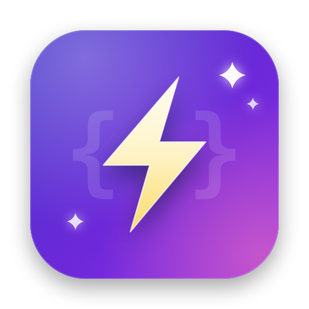
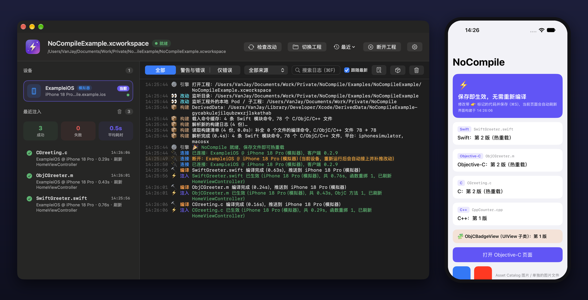

<div align="center">



# NoCompile

**Hot reload for iOS / macOS — C, C++, Objective-C and Swift**

Edit code, save, and see the change in your running app right away, without waiting for a full rebuild.

**Download: [Apple silicon (arm64)](https://github.com/wangwanjie/NoCompile/releases/latest/download/NoCompile_arm64.dmg) · [Intel (x86_64)](https://github.com/wangwanjie/NoCompile/releases/latest/download/NoCompile_x86_64.dmg)**

[Home](https://wangwanjie.github.io/NoCompile/) · [Releases](https://github.com/wangwanjie/NoCompile/releases) · [Integration guide](Docs/Integration.md) · [Report an issue](https://github.com/wangwanjie/NoCompile/issues)

English · [简体中文](README.md)

</div>

## Main window



The left side of the console lists connected apps (one entry per simulator, device or macOS app) and recent injections (success / failure counts, average time; right-click to open the file in Xcode, and compile errors jump straight to the offending line). The right side is a color-coded log you can filter and search. The top bar switches projects, toggles "inject on save" and triggers "check changes" manually. The ⚡ icon in the menu bar offers the same actions.

---

## What is it

On a large project a full build takes minutes, even for a one-line change. NoCompile recompiles only the file you just edited, links it into a dynamic library (dylib), injects it into the running app and swaps the new implementation in. It usually takes 1–3 seconds.

It builds on the core ideas of [InjectionIII](https://github.com/johnno1962/InjectionIII), [HotReloading](https://github.com/johnno1962/HotReloading) and [InjectionNext](https://github.com/johnno1962/InjectionNext), and improves on their weak spots.

## How it improves on existing tools

| Area | Weakness of existing tools | NoCompile |
|---|---|---|
| **Getting compile commands** | Regex-scanning `.xcactivitylog` breaks whenever Xcode changes the format; or patching the Xcode toolchain and relying on private SourceKit logs | Parses the log for the module's driver command, then expands it into a single-file frontend command with the official `swiftc -###`. Flags come from the compiler itself, so Xcode upgrades are followed automatically |
| **Language support** | Some tools lack C++; Swift is function-replacement only | C / C++ / ObjC / Swift in one tool. C/C++ free functions are overridden through GOT rebinding |
| **In-process replacement** | ObjC swizzling, Dobby inline hooks and vtable patching each on their own | Three unified layers: ObjC `class_replaceMethod` + Swift vtable override + fishhook-style symbol rebinding |
| **Trigger** | Some tools require a manual shortcut by default | Inject on save via FSEvents; if a change is missed, click "Check changes" or press the global hotkey ⌃⌥⌘R |
| **Resources & new files** | storyboard / xib only on the simulator and only after Xcode built them; no images or new files | storyboard, xib and images take effect on save (devices included); source files created while running can be injected too |
| **Non-ASCII / spaces in paths** | Non-ASCII paths unsupported, spaces break things | Arguments are passed to subprocesses as arrays, never joined into a shell string, so any path works |
| **Device connection** | Finds the Mac by UDP broadcast, often fails | USB (usbmuxd) as the primary channel — stable |
| **Type checks** | `isKindOfClass:` / `as?` may fail after injection | Registers old/new class equivalence and fixes the checks |
| **UI refresh** | You must implement `injected()` and similar in business classes | Zero intrusion: new code takes effect on save, open screens show it after leaving and re-entering (optional auto-rebuild); `injected()` is only an optional compatibility hook |

## How it works

```
┌─────────────────────┐         socket          ┌──────────────────────┐
│   Mac side (engine)  │ ◄── simulator/macOS ──► │  In-app client        │
│                     │      TCP 21890           │  (NoCompile.framework)│
│  · watch file changes│                         │                       │
│  · parse build logs  │ ◄──── device USB ─────► │  · dlopen new dylib   │
│  · recompile → dylib │   usbmuxd → 21891       │  · ObjC method swap   │
│  · sign → push       │                         │  · Swift vtable patch │
│                     │                          │  · symbol GOT rebind  │
│  CLI / menu bar app  │                         │  · call injected()    │
└─────────────────────┘                          └──────────────────────┘
```

- **Mac side**: NoCompile.app (a menu bar app with a built-in command-line tool). Download it from [Releases](https://github.com/wangwanjie/NoCompile/releases).
- **Client** (`NoCompileClient`, the source in this repository): linked into the app as a Debug-only library (SPM / CocoaPods / Carthage), or loaded at runtime as a bundle. It connects to the Mac side automatically and applies received dylibs in-process.

## Quick start

### 1. Install NoCompile

Download the DMG for your chip and drag it into Applications:

| Chip | Download (always the latest) |
|---|---|
| Apple silicon (M series) | [NoCompile_arm64.dmg](https://github.com/wangwanjie/NoCompile/releases/latest/download/NoCompile_arm64.dmg) |
| Intel | [NoCompile_x86_64.dmg](https://github.com/wangwanjie/NoCompile/releases/latest/download/NoCompile_x86_64.dmg) |

Not sure which chip you have? Apple menu → About This Mac: "Chip: Apple M…" means arm64, "Intel" means x86_64. Each release ships a `SHA256SUMS.txt`. The installer is notarized by Apple; later versions update automatically through Sparkle and only receive updates for the same architecture. If you installed the Intel build on Apple silicon, the next update switches you to arm64.

On first run, if your project lives in Documents, Desktop or Downloads, macOS asks whether NoCompile may access it — click Allow.

### 2. Integrate your app

In your app's **Debug** configuration only:

**a. Add a linker flag** — Build Settings → Other Linker Flags (Debug):

```
-Xlinker -interposable
```

This makes calls inside the app go through the GOT, so they can be redirected to the new implementation at runtime.

**b. Add the client**, pick one:

| Method | How | Device |
|---|---|---|
| Swift Package Manager | Add `https://github.com/wangwanjie/NoCompile`, add the `NoCompile` library to the app target | ✅ |
| CocoaPods | `pod 'NoCompile', :configurations => ['Debug']` | ✅ |
| Carthage | `github "wangwanjie/NoCompile"`, exclude it in Release with `EXCLUDED_SOURCE_FILE_NAMES` | ✅ |
| Copy the bundle (zero dependencies, **recommended**) | A Run Script calls `nocompile_copy_bundle.sh`, then load `NoCompile.bundle` from the app | ✅ |
| Load the bundle from NoCompile.app | `Bundle(path: "/Applications/NoCompile.app/Contents/Resources/iOSNoCompile.bundle")?.load()` | ❌ Simulator / macOS only |
| `DYLD_INSERT_LIBRARIES` (no code) | Point to the executable inside the bundle in the scheme's environment variables | ❌ Simulator / macOS only |

> [!IMPORTANT]
> **To hot reload on a real device, do not load the client from `/Applications/NoCompile.app`.** That path exists only on the Mac: simulator processes share the Mac's filesystem so it works there, but on a device `bundleWithPath:` returns nil and `load` fails silently — it works on the simulator and never connects on the device. On devices use one of the first four methods; if you want no dependency, use "Copy the bundle", which works on both simulator and device:
>
> 1. Add a Run Script at the end of the app target's Build Phases: `"/Applications/NoCompile.app/Contents/Resources/nocompile_copy_bundle.sh"`
> 2. Load the bundle inside the app:
>
> ```objc
> #if DEBUG
> NSString *path = [[NSBundle mainBundle] pathForResource:@"NoCompile" ofType:@"bundle"];
> if (path) {
>     [[NSBundle bundleWithPath:path] load];
> }
> #endif
> ```
>
> ```swift
> #if DEBUG
> if let path = Bundle.main.path(forResource: "NoCompile", ofType: "bundle") {
>     Bundle(path: path)?.load()
> }
> #endif
> ```

> [!TIP]
> If the integration changes are awkward to commit, or you have to redo them after switching branches, a one-shot script applies the "Copy the bundle" setup automatically (linker flag, Run Script, loading code inserted at the top of `didFinishLaunching`, Swift / Objective-C and platform detected for you) and `--remove` reverts it exactly before you switch branches:
>
> ```bash
> /Applications/NoCompile.app/Contents/Resources/nocompile_setup.py            # run in the project directory
> /Applications/NoCompile.app/Contents/Resources/nocompile_setup.py --remove   # revert
> ```
>
> CocoaPods projects can also use `--install-pod-hook` to add a committable hook to the Podfile; after `export IntegrateNoCompile=true` on your machine, `pod install` integrates automatically. See the [integration guide](Docs/Integration.md).

The link-based methods start automatically when the image loads, and the bundle method starts on `load()`; no extra startup code is needed. Full steps and caveats for each method are in the [integration guide](Docs/Integration.md), and troubleshooting for devices that won't connect is in the same document.

### 3. Pick a project

Click the ⚡ icon in the menu bar → Choose Project.

Logs are available from ⚡ → Open Console and are also written to `~/Library/Logs/NoCompile/NoCompile.log`. When something goes wrong, click the 📦 button in the console log bar (or ⚡ → Export Diagnostics…) to export a zip containing per-stage diagnostics, the full command and output of failed compiles, and call stacks captured automatically when the main thread hangs. Send it to the developer to investigate.

Then press `Command+R` to run your app. Edit any source file and save; the change shows up in the app within seconds.

Status icon colors: the menu bar text color means ready, orange means compiling / injecting, red means error, gray means not watching.

### Verify the environment

You can check that the recompile pipeline works without integrating an app (build the project once in Xcode first). The command-line tool is bundled inside the app:

```bash
/Applications/NoCompile.app/Contents/Helpers/nocompile selftest /path/to/YourApp.xcworkspace macosx /path/to/SomeFile.swift
```

The third argument can be `macosx` / `iphonesimulator` / `iphoneos`.

## Limitations

Hot reload mainly replaces **function bodies**; changing only method bodies (without changing the number or order of methods / properties) takes effect immediately. The following changes alter a class's memory layout, so NoCompile **does not replace that class's implementation** to avoid crashes, and tells you in the log and an in-app overlay to rerun the app:

- Adding, removing, reordering or retyping stored properties / ObjC instance variables (existing instances use the old layout, new code would read and write out of bounds);
- Adding, removing or reordering Swift methods (the old metadata's vtable is fixed, dispatching through new slots would call other methods);
- A changed view structure returned from SwiftUI `some View` (different concrete type; replacing it would corrupt memory). Add `.enableInjection()` at the end of `body` (or wrap in `AnyView`) to hot reload structural changes.

Other classes in the same file whose layout is unchanged, and free functions, still take effect.

Other notes:

- You must build the project fully in Xcode once so NoCompile can get compile commands from the build log.
- storyboard, xib, images and new source files are also hot reloaded; see the [integration guide](Docs/Integration.md) for scope and limits.
- Supports iOS / tvOS 15+ (the minimum deployment target of Xcode 27) and macOS 12+; Mac Catalyst is experimental. Device injection requires signing with the same developer identity as the app (NoCompile extracts it from the build log automatically).
- Whole Module Optimization and the compilation cache (`COMPILATION_CACHE_ENABLE_CACHING`) are not supported yet; they are off by default in Debug.

## SwiftUI

SwiftUI views refresh through notifications. After each injection NoCompile posts `NoCompileDidInjectNotification` (and `INJECTION_BUNDLE_NOTIFICATION`, compatible with Inject / HotSwiftUI). Combined with the community `@ObserveInjection` the view redraws automatically; `.enableInjection()` at the end of `body` erases the return type to `AnyView`, which is what lets structural changes such as adding or removing child views hot reload.

## Repository contents

This repository holds NoCompile's client SDK and release files; the Mac app is distributed as an installer on [Releases](https://github.com/wangwanjie/NoCompile/releases).

```
Package.swift        Swift Package (NoCompile client library only, no third-party dependencies)
NoCompile.podspec    CocoaPods spec
Client/              Xcode project for the client: framework for Carthage
Sources/
  NoCompileClient/   In-app client (ObjC/C)
Tests/               Client unit tests (swift test, runs on macOS)
Docs/                Integration guide
Scripts/             Device diagnostics script
appcast*.xml         Sparkle update feeds
release-notes/       Release notes per version
index.html, assets/  Home page
```

Each version tag (`vX.Y.Z`) points to the commit containing that version's client SDK; SPM, CocoaPods and Carthage fetch by tag.

## Star history

[](https://star-history.com/#wangwanjie/NoCompile&Date)

## License

The client SDK is open source under the MIT License; see [LICENSE](LICENSE).
