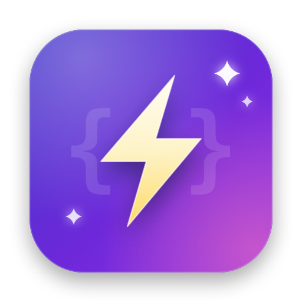

<div align="center">



# NoCompile

**iOS / macOS 热重载工具，支持 C、C++、Objective-C、Swift**

修改代码，保存，立即在运行中的 App 看到效果，无需等待整个工程重新编译。

[下载最新版](https://github.com/wangwanjie/NoCompile/releases/latest) · [接入指南](Docs/Integration.md) · [架构与原理](Docs/Architecture.md) · [示例工程](Examples/NoCompileExample)

</div>

---

## 这是什么

大型工程一次编译动辄几分钟，改一行代码也要等很久。NoCompile 的做法是：只重新编译你刚改动的那一个文件，链接成一个动态库（dylib），注入到正在运行的 App 里，把新实现替换掉旧实现。整个过程通常在 1~3 秒内完成。

它借鉴了 [InjectionIII](https://github.com/johnno1962/InjectionIII)、[HotReloading](https://github.com/johnno1962/HotReloading)、[InjectionNext](https://github.com/johnno1962/InjectionNext) 的核心原理，并针对它们的短板做了改进。

## 相比现有工具的改进

| 维度 | 现有工具的短板 | NoCompile 的做法 |
|---|---|---|
| **获取编译命令** | 纯正则扫描 `.xcactivitylog`，Xcode 升级后格式一变就失效；或改写 Xcode 工具链、依赖 SourceKit 私有日志 | 解析日志拿到模块的 driver 命令后，交给官方 `swiftc -###` 展开出单文件的 frontend 命令。参数由编译器自己生成，Xcode 升级能自动跟随 |
| **语言支持** | 部分工具不支持 C++，Swift 仅支持函数替换 | C / C++ / ObjC / Swift 统一支持。C/C++ 自由函数通过 GOT 重绑覆盖 |
| **进程内替换** | ObjC swizzle、Dobby inline hook、vtable patch 各自为政 | 统一三层：ObjC `class_replaceMethod` + Swift vtable 覆写 + fishhook 式符号重绑 |
| **触发方式** | 部分工具默认要手动按快捷键 | 保存即注入，FSEvents 自动触发 |
| **资源与新文件** | storyboard / xib 仅限模拟器且依赖 Xcode 先编译，不支持图片与新增文件 | storyboard、xib、图片保存即生效（含真机）；运行中新建的源文件也能注入 |
| **中文 / 空格路径** | 明确不支持中文路径，空格路径也会出错 | 全程用参数数组传递给子进程，不拼接 shell 字符串，天然支持 |
| **真机连接** | 靠 UDP 广播找 Mac，常连不上 | 以 USB（usbmuxd）为主通道，稳定可靠 |
| **类型判定** | 注入后 `isKindOfClass:` / `as?` 可能失效 | 登记新旧类等价关系并修正判定 |
| **界面刷新** | 需要在业务类里实现 `injected()` 等与业务无关的方法 | 零侵入：新代码保存即生效，已打开的页面退出重进即可看到（可选开启自动重建），`injected()` 仅作可选兼容 |

## 架构

```
┌─────────────────────┐         socket          ┌──────────────────────┐
│   Mac 端（引擎）     │ ◄──── 模拟器/macOS ────► │   App 进程内客户端    │
│                     │      TCP 21890           │   (NoCompile.framework)│
│  · 监听文件变化      │                          │                       │
│  · 解析构建日志      │ ◄──── 真机 USB ────────► │  · dlopen 新 dylib    │
│  · 单文件重编 → dylib│   usbmuxd → 21891        │  · ObjC 方法替换       │
│  · 签名 → 推送       │                          │  · Swift vtable 覆写   │
│                     │                          │  · 符号 GOT 重绑       │
│  CLI / 菜单栏 App    │                          │  · 遍历实例 injected() │
└─────────────────────┘                          └──────────────────────┘
```

- **Mac 端引擎**（`NoCompileKit`）：定位 DerivedData、解析 `.xcactivitylog`、单文件重编、链接、签名、通过 socket 推送。被命令行工具 `nocompile` 和菜单栏 App `NoCompileApp` 共用。
- **客户端**（`NoCompileClient`）：以 Debug-only 的库形式链入 App（SPM / CocoaPods / Carthage），或以 bundle 形式在运行时加载，自动连接 Mac 端，收到 dylib 后在进程内完成替换。

详见 [Docs/Architecture.md](Docs/Architecture.md)。

## 快速开始

### 1. 安装 NoCompile

从 [Releases](https://github.com/wangwanjie/NoCompile/releases/latest) 下载 `NoCompile_vX.Y.Z.dmg`，拖入「应用程序」即可。安装包已经过 Apple 公证，后续版本会通过 Sparkle 自动更新。

也可以从源码构建（需要 [XcodeGen](https://github.com/yonaskolb/XcodeGen)）：

```bash
Scripts/build-app.sh --open
```

> 不要在 Xcode 里打开 NoCompile 的 `Package.swift` 来运行它。Xcode 不允许同一个本地包被两个窗口同时打开，会和以本地包方式引用 NoCompile 的 App 工程冲突。

首次运行时，如果工程在「文稿」「桌面」「下载」目录下，macOS 会弹窗询问是否允许 NoCompile 访问，请点「允许」。

### 2. 接入 App 工程

在 App 的 **Debug** 配置里（务必只在 Debug）：

**a. 添加链接参数** — Build Settings → Other Linker Flags（Debug）：

```
-Xlinker -interposable
```

这一步让 App 内部的函数调用走 GOT 间接寻址，才能在运行时把调用重定向到新实现。

**b. 接入客户端**，任选一种：

| 方式 | 写法 |
|---|---|
| Swift Package Manager | 添加包 `https://github.com/wangwanjie/NoCompile`，把 `NoCompile` 库加到 App target |
| CocoaPods | `pod 'NoCompile', :configurations => ['Debug']` |
| Carthage | `github "wangwanjie/NoCompile"`，Release 配置用 `EXCLUDED_SOURCE_FILE_NAMES` 排除 |
| 加载 bundle（零依赖，模拟器 / macOS） | `Bundle(path: "/Applications/NoCompile.app/Contents/Resources/iOSNoCompile.bundle")?.load()` |
| 拷贝 bundle（零依赖，支持真机） | Run Script 调用 `nocompile_copy_bundle.sh`，再加载 App 内的 `NoCompile.bundle` |
| `DYLD_INSERT_LIBRARIES`（零代码） | 在 scheme 环境变量里指向 bundle 内的可执行文件 |

链接方式在镜像加载时自动启动，bundle 方式在 `load()` 时启动，都无需再写启动代码。各方式的完整步骤与注意事项见 [接入指南](Docs/Integration.md)。

### 3. 选择工程

点击菜单栏的 ⚡ 图标 → 选择工程，或者启动时直接指定：

```bash
Scripts/build-app.sh --open --project /path/to/YourApp.xcworkspace
```

日志可在 ⚡ → 显示日志 查看，同时写入 `~/Library/Logs/NoCompile/NoCompile.log`。遇到问题时点控制台日志栏的 📦 按钮（或菜单 ⚡ → 导出诊断包…）导出 zip，里面有各环节的诊断日志、编译失败的完整命令与输出、主线程卡顿时自动采集的调用栈，发给开发者即可排查。

然后 `Command+R` 运行你的 App。编辑任意源文件并保存，几秒后就能在 App 看到改动生效。

状态栏图标颜色：绿色表示就绪，黄色表示执行中，红色表示出错。

### 验证环境

不接入 App 也能先验证重编流水线是否正常（需先在 Xcode 完整构建过一次）：

```bash
nocompile selftest /path/to/YourApp.xcworkspace macosx /path/to/SomeFile.swift
```

第三个参数可以是 `macosx` / `iphonesimulator` / `iphoneos`。

## 使用约束

热重载的主体是替换**函数体**，仅改方法体（不动方法/属性数量）即时生效。增删方法或存储属性改变了内存布局，这类改动不再拒绝注入、也不会崩溃，按下面的规则处理：

- **ObjC / @objc 方法**：增删改都即时生效（运行时动态派发，`class_replaceMethod` 可安全地新增方法）。
- **纯 Swift 的增删方法 / 存储属性**：会加载新代码，屏幕上已存在的旧实例保持原样——旧实例的 vtable 槽位数和实例大小在分配时已固定，Debug（`-Onone`）下方法走 vtable 静态派发，在旧实例上覆写或重跑生命周期会越界崩溃。重新运行 App 后，新代码由走新元数据的新实例体现；日志会列出发生布局变化的类名。

改方法体随时热重载；加减 Swift 的方法/属性会安全加载并提示重新运行 App。

其他要点：

- 必须先在 Xcode 完整构建过一次，NoCompile 才能从构建日志拿到编译命令。
- storyboard、xib、图片与新增源文件也支持热重载，范围与限制见 [接入指南](Docs/Integration.md#资源与新增文件)。
- 真机注入需要 iOS 13+，并用与 App 一致的开发者身份签名（NoCompile 会从构建日志自动提取签名身份）。
- 暂不兼容 Whole Module Optimization 和编译缓存（`COMPILATION_CACHE_ENABLE_CACHING`），Debug 配置默认关闭它们即可。

## SwiftUI

SwiftUI 视图的刷新依赖通知。每次注入后，NoCompile 会发出 `NoCompileDidInjectNotification`（同时发出与 Inject / HotSwiftUI 兼容的 `INJECTION_BUNDLE_NOTIFICATION`）。配合社区的 `@ObserveInjection` 即可自动重绘。

## 目录结构

```
Package.swift        接入方使用的 Swift Package（零第三方依赖）
NoCompile.podspec    CocoaPods 描述文件
Client/              客户端的 Xcode 工程：Carthage 用的 framework 与运行时加载的 bundle
Sources/
  NoCompileClient/   App 进程内客户端（ObjC/C）
  NoCompileKit/      Mac 端引擎（Swift）
  nocompile/         命令行工具
App/                 NoCompile.app（Xcode 工程由 project.yml 生成，集成 Sparkle）
Examples/            iOS / macOS 示例工程
Scripts/             构建、图标、打包、公证、发布脚本
Docs/                架构、接入指南、发布说明
```

## 发布新版本

1. 修改 `App/project.yml` 中的 `MARKETING_VERSION` 与 `CURRENT_PROJECT_VERSION`，并同步 `NoCompile.podspec` 的 `s.version` 与 `Client/project.yml` 的 `MARKETING_VERSION`。
2. 构建、签名并公证 DMG（会先用 `Scripts/build-client-bundles.sh` 构建客户端 bundle 并放进 App）：

   ```bash
   Scripts/build_dmg.sh
   ```

3. 创建 GitHub Release、上传 DMG，并更新 Sparkle 的 `appcast.xml`：

   ```bash
   Scripts/publish_github_release.sh --notes-file Docs/ReleaseNotes/X.Y.Z.md
   ```

4. 提交并推送 `appcast.xml`，已安装的用户会收到更新提示。
5. 发布 CocoaPods（tag 为 `vX.Y.Z`，由上一步的 Release 创建）：

   ```bash
   pod trunk push NoCompile.podspec
   ```

App 图标由 `swift Scripts/generate_icons.swift` 程序化生成。

## 许可证

MIT License，详见 [LICENSE](LICENSE)。
